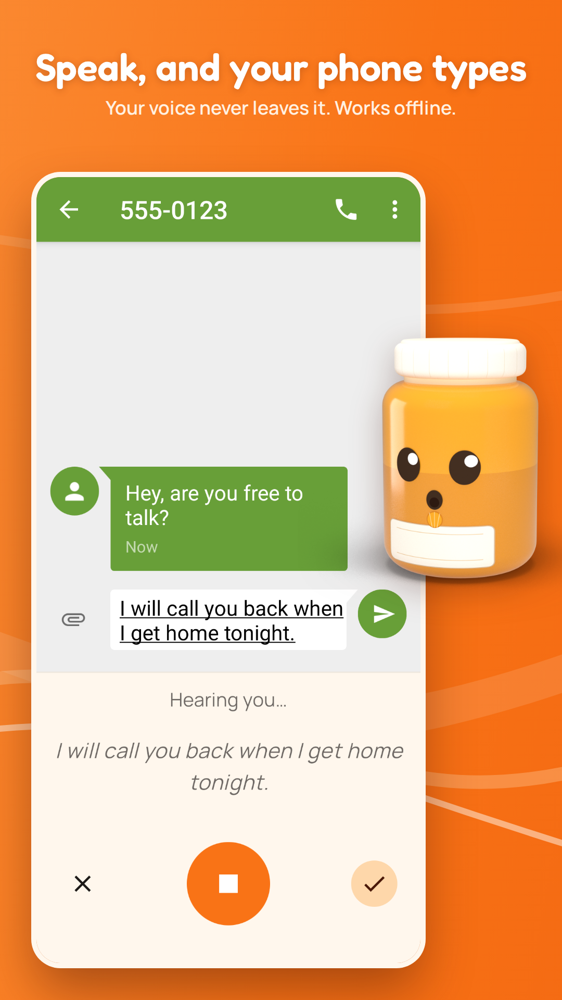
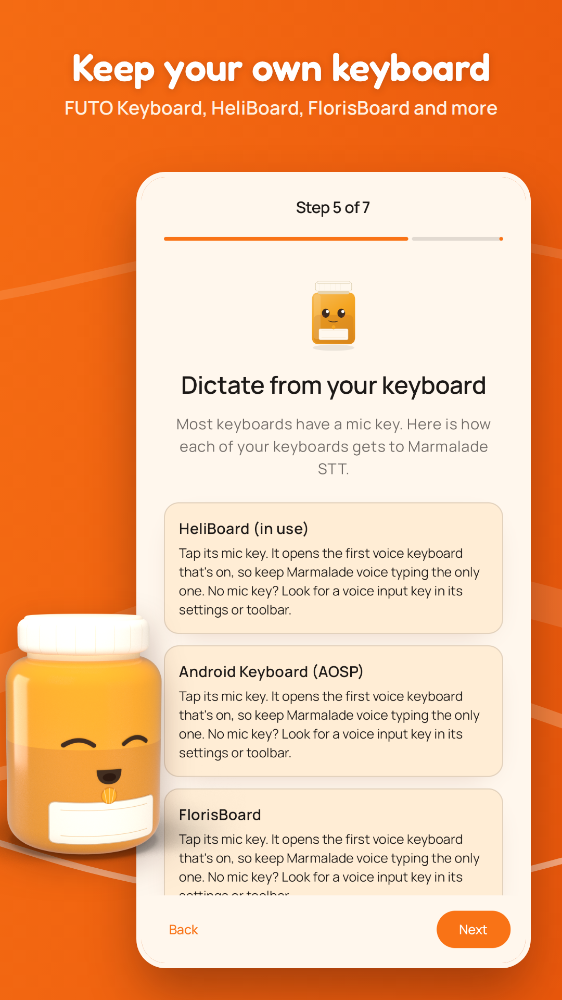
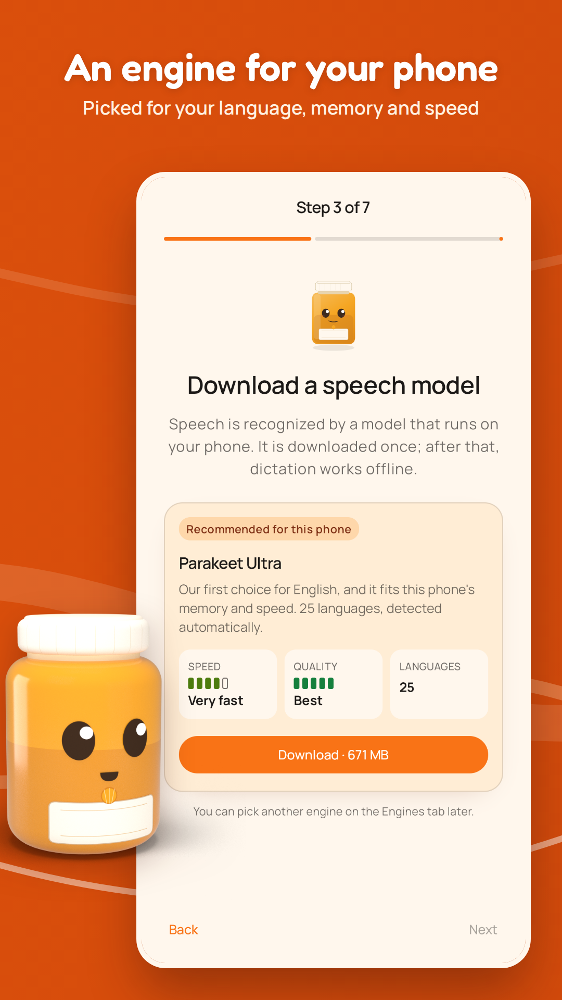
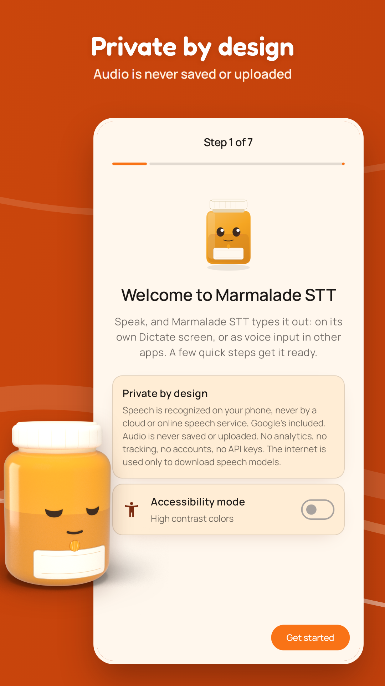

  

<h1 align="center">Marmalade STT</h1>

  <b>Private, offline speech-to-text for your keyboard. Your voice stays on device.</b>

  
  &nbsp;
  &nbsp;

  

  <a href="#install">Install</a> ·
  <a href="#features">Features</a> ·
  <a href="#setup">Setup</a> ·
  <a href="#works-with-your-keyboard">Keyboards</a> ·
  <a href="#engines">Engines</a> ·
  <a href="#benchmarks">Benchmarks</a> ·
  <a href="#private-by-design">Privacy</a> ·
  <a href="BUILDING.md">Building</a> ·
  <a href="CHANGELOG.md">Changelog</a> ·
  <a href="#support">Support</a>

---

Marmalade STT turns your speech into text on your phone. Use it as the voice
input of your keyboard, and of apps that ask Android for speech input. Your
voice never leaves the device.

Turn on "Marmalade voice typing" and your keyboard's mic key opens a small
Marmalade panel that types what you say. It works with HeliBoard,
FlorisBoard, AnySoftKeyboard, Unexpected Keyboard, Android's own keyboard and
others ([the full list](#works-with-your-keyboard)). The setup guide
recommends a speech engine for your language and for your phone's memory and
speed. After that one download, it works without a connection.

  
  &nbsp;
  &nbsp;
  &nbsp;

## Features

- **Private.** Speech is recognized on the phone. Audio is never saved or uploaded
- **Offline.** After a one-time download of a speech engine, it works without a connection
- **Live text.** Shows your words in real time as you speak, on most engines
- **Knows when you're done.** Smart Turn, the default for the speak-now popup, waits until you sound finished, so a pause to think rarely cuts you off
- **Multilingual.** 100 languages, with the best engine for yours picked automatically
- **Clean output.** Filler words removed, numbers as digits, your own replacements and verbal snippets
- **Free and open source.** No ads, no accounts, no analytics

## Install

Marmalade STT needs Android 9 or later.

- **[GitHub Releases](https://github.com/maxwhipw/marmalade-stt-android/releases)**:
  download the APK for your phone. Most phones need the `arm64-v8a` one;
  older 32-bit phones the `armeabi-v7a` one.
- **[F-Droid](https://f-droid.org/packages/app.marmalade.stt/)**: install
  it from the F-Droid app and it updates itself. F-Droid's builds are
  checked against ours, so they carry the same signature as the GitHub APKs.

Then open the app: the setup guide below walks you through the rest.

## Setup

On first launch a setup guide walks you through it; reopen it any time from
Settings → Setup guide. Every step but the speech model can be skipped.

1. **Microphone.** Allow it.
2. **Speech model.** The guide recommends one engine for your language
   (Settings → Recognition language, Auto by default) and your phone's
   memory and speed (see "Engines"). Download it there; it is selected when
   it finishes. The guide moves on once a model is installed, because the
   next steps try dictation. The download keeps going if the screen turns
   off or you leave the app.
3. **Voice keyboard.** Turn on "Marmalade voice typing" in Android's
   keyboard settings.
4. **Dictate from your keyboard.** The guide lists the keyboards you have
   turned on and says how each one's mic key gets to Marmalade (see "Works
   with your keyboard"). It warns when another voice keyboard, such as
   Google voice typing, is on, and has a box to try your mic key in.
5. **Speech recognition for other apps** (on phones that have this
   setting). Pick Marmalade STT as Android's speech recognition service;
   the guide opens the screen. Force-stopping the app makes Android switch
   back, so pick it again then.
6. **Try it** on the Dictate tab.

Settings → Appearance sets **Mode** (System, Light or Dark) and **Color**
(Marmalade, Midnight, Forest or Berry; Wallpaper on Android 12 and later);
the voice keyboard and the speak-now popup follow it.

## Private by design

No analytics, no tracking, no crash reporting, no accounts, and no server of
ours. Speech is recognized on the phone, and audio is never saved or
uploaded. The internet is used only to download the speech engines you
choose, from GitHub, and every file is checked against a
pinned SHA-256 hash. Android backup is turned off, so nothing is copied to
the cloud. Privacy policy: [PRIVACY.md](PRIVACY.md).

## When it stops

In the speak-now popup and other apps, Marmalade uses Smart Turn v3 by
default to detect when you have finished speaking. If it cuts you off too
early, switch to stopping at a pause, or set an end word instead. On the
keyboard it listens until you tap, or it can use Smart Turn too. Settings →
End of speech:

- **Voice keyboard**: **Tap to stop** by default, or one of the auto-stop
  options below; the first end then types your words and closes the
  keyboard, as ✓ does.
- **Other apps and the speak-now popup** (and Android's speech
  recognizer): **Auto-stop with Smart Turn** by default, or another
  auto-stop option.
- **Dictate screen**: stops only when you tap the mic, and adds your words
  at each pause.

The auto-stop options:

- **Auto-stop with Smart Turn**: after a short pause, a small bundled model
  (pipecat's smart-turn v3.2, 8.7 MB) judges whether you sounded finished,
  so a pause to think doesn't cut you off; after a longer silence it stops
  anyway. **Smart Turn patience** (Quick, Normal, Relaxed) sets how long it
  waits.
- **Auto-stop after a pause**: stops at the first pause of the **Pause
  length** you set (1.2 seconds by default), which also ends a sentence on
  the Dictate screen.
- **Say an end word** ("over" by default; list several separated by
  commas): stops when you say it on its own. "He fell over" doesn't count,
  and the word isn't typed.

On the voice keyboard and the speak-now popup, press and hold the mic in an
auto-stop mode to keep listening through every pause until you tap it.

## Clean text

Optional cleanup (Settings → Text cleanup) fixes capitals, and in English
removes filler words, turns "new line" and "period" into the real thing
(Voice commands, with Punctuation words under it) and writes numbers as
digits. Replacements for names the engine gets wrong, and snippets for text
you type often, work in any language. Phrases an engine "hears" in silence,
like "Thank you.", are removed when the mic heard only silence; a "Thank
you." you really say stays. The rules: [textproc/README.md](textproc/README.md).

## Works with your keyboard

Turn on "Marmalade voice typing" and your keyboard's mic key opens a small
Marmalade panel that types what you say. Tested on an Android 15 emulator in
October 2026 with the versions shown, unless the table says otherwise:

| Keyboard | Its mic key | Works with Marmalade? | What to do |
|---|---|---|---|
| FUTO Keyboard 0.1.30 | Its Voice Input setting | Yes (also on a Pixel 8a) | See "Use with FUTO Keyboard" below |
| HeliBoard 4.1 | Opens the first voice keyboard that's on (toolbar mic) | Yes | Keep Marmalade the only voice keyboard that's on |
| Android's own keyboard (AOSP; LineageOS, GrapheneOS…) | Opens the first voice keyboard that's on | Yes | Keep Marmalade the only voice keyboard that's on |
| FlorisBoard 0.5.2 | Opens the first voice keyboard that's on | Yes | Keep Marmalade the only voice keyboard that's on |
| AnySoftKeyboard 1.13 | Opens the first voice keyboard that's on; with none on, Android's speech input | Yes, both ways | Keep Marmalade the only voice keyboard that's on |
| Unexpected Keyboard 2.1.0 | Asks which voice keyboard the first time, then remembers | Yes | Pick "Marmalade voice typing" |
| Fossify Keyboard 1.9.1 | Its "Voice typing method" setting | Yes, see below | Set it to Marmalade voice typing |
| OpenBoard 1.4.5 | Opens the first voice keyboard that's on | Yes, see below | Keep Marmalade the only voice keyboard that's on |
| Thumb-Key 5.1.17 | A swipe on the emoji key; switches to each voice keyboard that's on, so the last one usually wins | Yes, see below | Keep Marmalade the only voice keyboard that's on |
| Indic Keyboard | Opens the first voice keyboard that's on (from its source) | Not tested | Keep Marmalade the only voice keyboard that's on |
| SwiftKey | Microsoft's voice typing; with "Multi-modal voice typing" off (Rich input), Android's speech input | Maybe, not tested | Turn off Multi-modal voice typing |
| Gboard 14.2 (Google Play emulator image) | Its own voice typing, inside Gboard; its only voice setting removes the key | Mic key: no. Keyboard switcher: yes | Switch with Android's keyboard button, see below |
| Samsung Keyboard | Samsung voice input or Google voice typing, per Samsung's help page | Not tested | — |
| Hacker's Keyboard 1.41.1 | Only Google voice typing | Mic key: no. Keyboard switcher: yes | Switch with Android's keyboard button, see below |
| Simple Keyboard 6.7 | No mic key | Mic key: no. Keyboard switcher: yes | Switch with Android's keyboard button, see below |

**Keep Marmalade the only voice keyboard that's on.** Android lists
preinstalled voice keyboards first, so Google voice typing wins while it is
on. Turn it off in Android's keyboard settings (on most phones Settings →
System → Keyboard → On-screen keyboard); it stays installed.

**Gboard**'s mic key always starts Gboard's own voice typing, also with
Google voice typing turned off. Android's keyboard switcher still reaches
Marmalade: while Gboard is up, tap the keyboard button at the bottom right
of the navigation bar, pick "Marmalade voice typing", speak, and tap ✓ to
type the text and go back to Gboard. The switcher is Android's, not the
keyboard's, so it works the same from any keyboard whose mic key can't
reach Marmalade (tested with Gboard).

**Fossify Keyboard, OpenBoard and Thumb-Key** (on Android 14 and later)
don't ask Android to show them other keyboards, so Android shows them
Marmalade only after you've typed in Marmalade STT with them, and forgets it
at every restart. Type a letter in the setup guide's "Try it here" box with
that keyboard, once after each restart.

### Use with FUTO Keyboard

1. Turn on the Marmalade voice keyboard (setup step 3).
2. In FUTO Keyboard: Settings → Voice Input, turn on "Disable built-in
   voice input" ("Use voice input provided by external app"). FUTO versions
   that can be asked get a button for this in the setup guide instead;
   FUTO Keyboard 0.1.30 can't, so the guide shows these steps.
3. Tap FUTO's mic key. The Marmalade panel opens and listens straight away;
   the words in progress show underlined. Tap ✓ to type them, or ✕ to throw
   away the sentence in progress; either one (or Back) returns to FUTO. The
   mic button pauses and resumes listening.

*(Checked with FUTO Keyboard 0.1.30 on a Pixel 8a and on the emulator.)*

### Other apps

- Apps with a "speak now" button that ask Android for speech input get a
  small Marmalade sheet, which returns what you say at the first end (Smart
  Turn by default). Tap the mic or Done to finish sooner.
- Apps that use Android's speech recognizer use Marmalade STT once you pick
  it as the speech recognition service (the setup guide's speech step opens
  the nearest Settings page): Settings → System → Language & region →
  Speech → Voice input on Android 17 (and Android 16 phones with Language &
  region), System → Languages → Voice input on 14 to 16, System →
  Languages & input → Voice input on 13, Apps → Default apps → Digital
  assistant app → Voice input on 12, and Apps & notifications → Advanced →
  Default apps → Assist & voice input (Assist app on 10, Digital assistant
  app on 11) → Voice input on 9 to 11. On 9 to 11 Voice input only shows once
  the assistant there is set to None.

## Engines

The setup guide recommends a speech engine for your language and for your
phone's memory and speed; you can download and try the others on the
Engines tab:

| Engine | Languages | Download | Live text |
|---|---|---|---|
| Parakeet Ultra (the default) | 25 European, detected | 671 MB | while you speak |
| Parakeet 110M | English | 136 MB | while you speak |
| Parakeet Japanese | Japanese | 656 MB | while you speak |
| Canary 180M Flash | English, Spanish, German, French (it can't detect which) | 207 MB | while you speak |
| Nemotron 3.5 | Hindi, Arabic, Vietnamese | 682 MB | streamed as you speak |
| Qwen3-ASR | 30, detected | 987 MB | when you pause |
| Whisper Large v3 Turbo | 100, detected | 1.0 GB | when you pause |

The recommendation: Parakeet Ultra when it knows your language, Parakeet
Japanese for Japanese, Qwen3-ASR for Chinese and Korean, Nemotron 3.5 for
Hindi, Arabic and Vietnamese, otherwise Whisper Large v3 Turbo, which is
slow on most phones. A phone short of memory or speed gets Parakeet 110M
for English, or Canary 180M Flash for Spanish, German and French. A slower
engine is recommended only where our tests found it clearly more accurate
([Benchmarks](#benchmarks)).

Upstream models: Parakeet Ultra is Moondream's post-trained Parakeet TDT
0.6B v3, Parakeet 110M is NVIDIA's Parakeet TDT_CTC 110M and Parakeet
Japanese NVIDIA's Parakeet TDT_CTC 0.6B ja (it writes few commas; the app
ends each sentence with 「。」). Canary needs to be told the language: on
Auto it uses the phone's language, and its card says so when that isn't one
of its four.

Each card shows how fast the engine is **on this phone** (a four-step
meter; the app measures the phone the first time, in about a second), its
quality from our tests (a five-step meter, measured in the language you
dictate in where we could, otherwise in English or the engine's own language
and marked so) and its languages. **Use**
picks an installed engine; **Show more** opens the details, the license and
the source. Engines too slow for the phone, and other engines you have
downloaded, are under **Other engines**. *The speed figures are desktop
measurements scaled to a phone, checked on a Pixel 8a for every user
engine (`docs/benchmarks/2026-10-pixel8a-ort.md`).*

Settings → Speech → **Keep engine ready** (off by default) keeps the engine
in memory while the app is open, so listening starts faster, at the cost of
about 0.6 to 3 GB of memory. With it off, a phone with 6 GB of memory or
more keeps the engine for five minutes after you last used it, so the voice
keyboard opened again within that time listens at once; smaller phones free
it right away.

Engines still being tried out, and an A/B benchmark to compare engines on
your own voice, are under Settings → Developer → Developer engines (off by
default; see [BUILDING.md](BUILDING.md#developer-engines)).

## Benchmarks

How accurate and how fast each engine the app recommends is, measured with
the app's own engine files and audio pipeline. Lower is better in both
columns.

| Engine | Recommended for | Error rate | Time to transcribe, vs Parakeet Ultra |
|---|---|---|---|
| Parakeet Ultra | 25 European languages | English 5.5 % WER¹; Spanish 3.8, German 6.5, French 7.9 % WER² | 1× |
| Parakeet 110M | English, on phones short of memory or speed | English 6.9 % WER¹ | 0.4× |
| Canary 180M Flash | Spanish, German and French, on phones short of memory or speed | English 8.4 % WER¹; Spanish 8.0, German 8.4, French 11.7 % WER² | 1.9× |
| Parakeet Japanese | Japanese | 5.4 % CER (FLEURS, 200 clips) | 1.0× |
| Qwen3-ASR | Chinese, Korean | Chinese 9.2 % CER (FLEURS), 2.7 % (AISHELL-1); Korean 6.5 % CER (FLEURS), 4.9 % (Zeroth-Korean); English 6.7 % WER¹ | 5.2× |
| Nemotron 3.5 | Hindi, Arabic, Vietnamese | Hindi 14.4, Arabic 10.6, Vietnamese 15.0 % WER (FLEURS, 100 clips each) | 2.8× |
| Whisper Large v3 Turbo | Every other language | English 7.0 % WER¹; Spanish 3.1, German 5.8, French 9.4 % WER² | 10× |

¹ The mean of four public test sets: LibriSpeech test-clean and test-other
(read audiobooks), FLEURS and AMI (meetings), 200 clips each.

² FLEURS, 50 clips per language, so differences under about 3 points are
noise.

WER is the share of words the engine got wrong; CER counts characters, for
Japanese, Chinese and Korean. Accuracy was measured on a desktop computer
running the app's engine files. Speed is the time to transcribe the same 11
LibriSpeech clips on a mid-range 2024 phone (Pixel 8a, 4 threads), relative
to Parakeet Ultra, which needs about 0.75 seconds for 10 seconds of speech
there (Parakeet Japanese was timed in a separate run of the same kind, with
two Japanese clips added). A faster phone speeds up every engine by about
the same factor. Method and full results: [docs/benchmarks/](docs/benchmarks/), mainly
[2026-09-host-wer.md](docs/benchmarks/2026-09-host-wer.md) (English, Spanish,
German, French), [2026-10-japanese.md](docs/benchmarks/2026-10-japanese.md),
[2026-10-nemotron-decision.md](docs/benchmarks/2026-10-nemotron-decision.md)
(Chinese, Korean, Hindi, Arabic, Vietnamese) and
[2026-10-pixel8a-mem.md](docs/benchmarks/2026-10-pixel8a-mem.md) (speed).

## Languages

Fast engines cover English, Bulgarian, Croatian, Czech, Danish, Dutch,
Estonian, Finnish, French, German, Greek, Hungarian, Italian, Latvian,
Lithuanian, Maltese, Polish, Portuguese, Romanian, Russian, Slovak,
Slovenian, Spanish, Swedish, Ukrainian, Japanese, Hindi, Arabic and
Vietnamese. Chinese and Korean get Qwen3-ASR, lighter than Whisper. You
can also pick it for its 28 other languages, English included. Other
languages work through Whisper Large v3 Turbo, with more delay.
Settings → **Recognition language** is the language you speak: Auto (the
phone's language) or one you pick. It decides the recommended engine and is
passed to the engines that take a hint.

The app itself is in 21 languages: English, Arabic, Chinese (Simplified and
Traditional), Czech, Dutch, French, German, Hindi, Indonesian, Italian,
Japanese, Korean, Polish, Portuguese (Brazil), Russian, Spanish, Swedish,
Turkish, Ukrainian and Vietnamese. It follows the phone's language (Android
13 and later: Settings → Apps → Marmalade STT → Language). The privacy policy
(with a translated summary), the licenses screen and the English-only cleanup
words stay English. Translation rules: [docs/i18n/](docs/i18n/).

## Open source

Marmalade STT is MIT licensed. Every component's and speech engine's license
is in [NOTICE.md](NOTICE.md) and under Settings → About → Open-source
licenses. To build it yourself, see [BUILDING.md](BUILDING.md); design
decisions are in [docs/ARCHITECTURE.md](docs/ARCHITECTURE.md), and every
change in [CHANGELOG.md](CHANGELOG.md).

## Support

If you'd like to support it, Settings → Support links to
[GitHub Sponsors](https://github.com/sponsors/maxwhipw); the app is the same
either way. Donations are voluntary and not tax-deductible. Found a bug?
Settings → Support → Report a bug, or
[open an issue](https://github.com/maxwhipw/marmalade-stt-android/issues).
